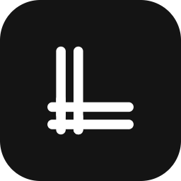
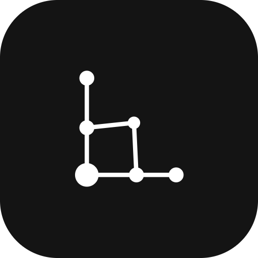

<div align="center">



# Loom OS

**Unified agent memory fabric**

</div>

**Loom OS** weaves multiple AI coding agents — Claude Code, Codex, Cursor, Hermes, Kimi Code, ZCode, and more — into one shared, [Graphify](https://github.com/nousresearch/graphify)-powered knowledge graph per project. Agents talk to Loom **through the filesystem**: drop a file in a per-project inbox and the daemon does the rest. No SDK or API client required for agents. A Next.js dashboard is the control plane for browsing the graph, chatting with the built-in **Loom Agent**, managing workers, and dispatching work.

> **Naming.** Product: **Loom OS**. Package: **`loom-os`** (`pip install loom-os`). CLI: **`loom`**. Repo / design docs: **`agentic-os`**. Same project.

**Start here:** [User Guide](docs/USAGE.md) · [Docs site](docs-site/index.md) · [API](docs/API.md) · [CLI](docs-site/reference/cli.md) · [Discussions](https://github.com/mohamedhusseinios/Loom-OS/discussions) · [Contributing](CONTRIBUTING.md)

---

## Quick Start

**From this repo (one command):**

```bash
./run.sh            # starts daemon :8472 + dashboard :3000 (creates .venv / installs deps if needed)
./run.sh --open     # same, then opens the dashboard in your browser
./run.sh --help     # flags: --reload, --port, --auth-token, --dashboard-port, …
```

**From PyPI (daemon only), then wire a project:**

```bash
pip install loom-os                              # base install — no LLM keys required
loom start                                       # daemon → http://127.0.0.1:8472
loom init --project my-app --project-path .      # inbox + starter register.json (+ wires agents)
loom wire --project my-app                       # or wire MCP / CLAUDE.md / AGENTS.md / .cursorrules explicitly
cd dashboard && npm install && npm run dev       # http://localhost:3000
```

| What | Where |
|------|-------|
| Daemon (REST + WebSocket) | `http://127.0.0.1:8472` |
| Dashboard | `http://localhost:3000` |

**Prerequisites:** Python 3.11+, Node.js 20+, Git 2.25+. Graphify ships as a dependency (`graphifyy`).

```bash
pip install loom-os[llm]   # optional LLM extraction (Ollama / OpenAI / Claude)
pip install loom-os[mcp]   # optional MCP server extras
```

Full walkthrough: **[How to Use Guide](docs/USAGE.md)**.

---

## What's New

| Feature | What it does |
|---------|----------------|
| **Loom Agent + orchestration** | Dashboard chat agent grounded in project graph memory; Jev ranks hits; pluggable chat model proposes Accept / Dismiss / Implement |
| **`./run.sh`** | One-command local bring-up for daemon + dashboard |
| **`loom wire`** | Zero-config agent wiring — `CLAUDE.md`, `AGENTS.md`, `.cursorrules`, `.mcp.json` |
| **Cross-project federation** | Org-wide read-only search across indexed projects (`/api/federated/*` + Federation tab) |
| **Team mode** | Optional `--auth-token` / `LOOM_AUTH_TOKEN` for write-protected multi-user setups |
| **Hybrid search** | Text + vector + graph traversal; dashboard toggle + MCP `hybrid_search` |
| **Agent discovery** | Capability schemas, `match` API, Agent Directory UI |
| **Extractor plugins** | Drop-in extractors (`examples/plugins/`) + `GET /api/plugins` |
| **Client SDKs** | Python [`loom-client`](loom-client/) and JS [`clients/js`](clients/js/) inbox wrappers |
| **LangChain memory** | [`integrations/langchain-loom`](integrations/langchain-loom/) — `LoomMemory` on the shared graph |
| **More agents** | Built-in **Kimi Code** and **ZCode** (plus Claude Code, Codex, Cursor, Hermes, …) |
| **Remote dashboard** | `NEXT_PUBLIC_API_URL` / `NEXT_PUBLIC_WS_URL` / `NEXT_PUBLIC_LOOM_AUTH_TOKEN` |

---

## Capabilities

- **Multi-agent knowledge graph** — Graphify AST builds (zero API keys). Optional LLM layer adds semantic edges.
- **Filesystem inbox protocol** — `register.json`, `heartbeat.json`, `finding-*.md`, `decision-*.md`, `task-*.json` under `~/.loom/inbox/<project>/`. Processed files move to `.processed/`. Optional [`loom-client`](loom-client/) wraps the same protocol.
- **Zero-config agent wiring** — `loom wire` / `loom init` (wires by default; `--no-wire` to skip).
- **Next.js dashboard** — Cytoscape graph explorer, agent directory, hybrid search, Kanban board, federation explorer, Loom Agent chat, bilingual en/ar + RTL.
- **Loom Agent + orchestration loop** — grounds replies in project graph memory; Jev (TypeSafe System One) filters/ranks hits; pluggable chat model (DeepSeek default, BYOK OpenAI-compatible) proposes the next step. Suggestions are Accept / Dismiss until you Implement; then the worker runs in a git worktree.
- **Task dispatch + workers** — `loom worker` runs Running tasks in isolated **git worktrees** (`loom/task-<id>`) with `--max-budget-usd` spend caps; merge diffs from the UI.
- **Hybrid search** — text + vector + graph traversal in one query path.
- **Cross-project federation** — read-only org-wide index for search and reference discovery.
- **Optional team mode** — `loom start --auth-token <secret>` (or `LOOM_AUTH_TOKEN`); local solo use needs no auth.
- **MCP server** — `loom-mcp` exposes graph query, findings, hybrid search, federation tools.
- **Patterns, facts, ingest, evals** — evolved patterns, temporal facts, document ingest, audit log, snapshots/traces.
- **Single-process daemon** — no Docker, Neo4j, or cloud required. State in SQLite (`~/.loom/state.db`).

---

## Usage

### Local developer loop

```bash
./run.sh --open
# or:
loom start
loom init --project my-app --project-path /abs/path/to/repo
loom wire --project my-app --project-path /abs/path/to/repo
cd dashboard && npm run dev
```

### Wire agents without MCP by hand

```bash
loom detect-agents

loom register --agent claude-code --project my-app --project-path /abs/path \
  --capabilities code-analysis,refactoring
```

### Run a worker against the Kanban board

```bash
loom worker \
  --project my-app \
  --agent claude-code \
  --project-path /abs/path/to/repo \
  --max-budget-usd 5.0
```

Drag a task to **Running** (or Implement a Loom Agent suggestion). The worker creates a worktree, executes, posts progress, and lands the card in **Done** with a reviewable diff.

### Team / remote mode

```bash
export LOOM_AUTH_TOKEN="your-team-secret"
loom start --host 0.0.0.0 --port 8472 --auth-token "$LOOM_AUTH_TOKEN"

export NEXT_PUBLIC_LOOM_AUTH_TOKEN="your-team-secret"
export NEXT_PUBLIC_API_URL="http://192.168.1.50:8472"
export NEXT_PUBLIC_WS_URL="ws://192.168.1.50:8472/ws"
cd dashboard && npm run dev
```

Writes need `Authorization: Bearer <secret>`. WebSocket clients pass `?token=`. Details: [User Guide § Team Mode](docs/USAGE.md#8-team-mode--authentication).

### Federated search

```bash
curl "http://127.0.0.1:8472/api/federated/query?q=AuthService"
curl "http://127.0.0.1:8472/api/federated/stats"
```

Or open the **Federation** tab in the dashboard.

### MCP

```bash
loom-mcp
```

```json
{
  "mcpServers": {
    "loom": { "command": "loom-mcp", "args": [] }
  }
}
```

Or let `loom wire` write the MCP config for you.

### Optional SDKs & integrations

```bash
cd loom-client && pip install -e .          # Python inbox SDK
cd clients/js && npm install                # JavaScript inbox SDK
pip install langchain-loom                  # LangChain memory
```

The raw filesystem protocol always works without these packages.

---

## Architecture

```
Browser :3000 ──▶  ┌──────────────────────────────────┐
                   │       Next.js Dashboard          │
                   │  (graph · Kanban · Loom Agent)   │
                   └──────────────┬───────────────────┘
                                  │ REST + WebSocket
┌─────────────────────────────────┼───────────────────┐
│                  Loom Daemon (Python, :8472)          │
│                                                       │
│  watcher ──▶ router ──▶ registry / graph_engine ──▶ api
│                │              │                       │
│           (SQLite)      (Graphify CLI subprocess,     │
│           ~/.loom/       graph.json + federation)     │
│            state.db                                     │
│                                                       │
│  orchestrator / agent_runtime / jev + llm clients     │
│  worker (git worktree) · federation · auth            │
└───────────────────────────────────────────────────────┘
     ▲                  ▲                  ▲
~/.loom/inbox/proj   ~/.loom/inbox/proj   ~/.loom/inbox/proj
  Claude Code           Codex              Cursor / …
```

**Two processes:** Python daemon (`daemon/`, `:8472`) and Next.js dashboard (`dashboard/`, `:3000`).

**Module map:**

```
watcher.py              Inbox observer → asyncio loop
router.py               Filename dispatch; rate-limits graph updates
registry.py             SQLite agents / projects / tasks / agent chats
graph_engine.py         Graphify CLI + hybrid_query
graph_update_coordinator.py  Serializes register/update builds
orchestrator.py         Loom Agent loop: hybrid_query → Jev → chat → suggestions
agent_runtime.py        Chat history + suggest / accept / implement glue
jev_client.py           TypeSafe System One client (optional)
llm_client.py           OpenAI-compatible chat (DeepSeek default, BYOK)
federation.py           Cross-project read-only index
wiring.py               loom wire / init agent configs
plugins.py              Extractor plugin discovery
mcp_server.py           loom-mcp entry point
worker.py / runners.py  Task execution in git worktrees
auth.py                 Optional token middleware
```

---

## CLI Reference

| Command | Description |
|---------|-------------|
| `loom start` | Start daemon (`--host`, `--port`, `--reload`, `--log-level`, `--auth-token`) |
| `loom` / `loom --port 8472` | Shorthand for `loom start` |
| `loom init --project <name> --project-path <path>` | Bootstrap inbox + register; wires agents unless `--no-wire` |
| `loom wire --project <name>` | Zero-config MCP / instruction-file wiring |
| `loom register --agent <name> --project <name> --project-path <path>` | Register an agent |
| `loom unregister --agent <name> --project <name>` | Removal instructions (API / dashboard) |
| `loom detect-agents` | List agents detected on this machine |
| `loom worker --project <name> --agent <name> --project-path <path>` | Execute Running tasks (`--max-budget-usd`, `--once`, `--task`) |
| `loom-mcp` | Start the MCP server |

Full flag tables: [CLI reference](docs-site/reference/cli.md).

---

## Benchmarks

[`BENCHMARKS.md`](BENCHMARKS.md) — reproducible self-measured numbers (build time, node/edge counts, query latency). Reproduction runbook: [`benchmarks/README.md`](benchmarks/README.md).

Competitor rows (Cognee, Graphiti) stay `not measured` until a controlled Docker + Neo4j bench environment exists.

---

## Development

```bash
git clone https://github.com/mohamedhusseinios/Loom-OS.git
cd Loom-OS
./run.sh                  # or: python3 -m venv .venv && source .venv/bin/activate && pip install -e ".[dev]"
pytest tests/ -v
bash scripts/smoke-test.sh
cd dashboard && npm run dev
```

Companion packages in this repo:

- [`loom-client/`](loom-client/) — Pydantic-validated inbox protocol SDK
- [`clients/js/`](clients/js/) — JavaScript twin
- [`integrations/langchain-loom/`](integrations/langchain-loom/) — LangChain memory

See [Development Guide](docs/DEVELOPMENT.md) and [Contributing](CONTRIBUTING.md).

---

## Documentation

### Start here

| Doc | Covers |
|-----|--------|
| [**How to Use / User Guide**](docs/USAGE.md) | Setup, wiring, dashboard, workers, federation, team mode, troubleshooting |
| [**Docs site (MkDocs)**](docs-site/index.md) | Navigable docs source — [Quickstart](docs-site/quickstart.md), concepts, guides, reference |
| [Built site](site/index.html) | Generated static site (`mkdocs build`) |

### Core references

| Doc | Covers |
|-----|--------|
| [Architecture](docs/ARCHITECTURE.md) | Two-process design, module map, data flow |
| [Filesystem Protocol](docs/FILESYSTEM-PROTOCOL.md) | Every inbox file type, format, processing rule |
| [API Reference](docs/API.md) | REST + WebSocket — all endpoints and events |
| [CLI Reference](docs-site/reference/cli.md) | Every `loom` subcommand and flag |
| [Dashboard Guide](docs/DASHBOARD.md) | Pages, stack, i18n, components |
| [Task Board & Worker](docs/TASK-BOARD.md) | Kanban lifecycle, worktree isolation, merge |
| [Agent Lifecycle](docs/AGENT-LIFECYCLE.md) | Register → contribute → dispatch |
| [Development Guide](docs/DEVELOPMENT.md) | Structure, tests, daemon patterns |
| [Benchmarks](BENCHMARKS.md) | Numbers + [runbook](benchmarks/README.md) |
| [Contributing](CONTRIBUTING.md) | Contribution conventions |

### Docs-site guides & concepts

| Doc | Covers |
|-----|--------|
| [Filesystem protocol](docs-site/concepts/filesystem-protocol.md) | Inbox contract (docs-site) |
| [Knowledge graph](docs-site/concepts/knowledge-graph.md) | Graphify builds, LLM edges, sidecar store |
| [Connect Claude Code](docs-site/guides/connect-claude-code.md) | Register / heartbeat / SDK path |
| [Hybrid search](docs-site/guides/hybrid-search.md) | Text vs hybrid modes |
| [Custom extractor plugin](docs-site/guides/custom-extractor-plugin.md) | Plugin authoring |
| [API (docs-site summary)](docs-site/reference/api.md) | Condensed API index |

### Packages & integrations

| Package | Docs |
|---------|------|
| Python client | [`loom-client/README.md`](loom-client/README.md) |
| JavaScript client | [`clients/js/README.md`](clients/js/README.md) |
| LangChain memory | [`integrations/langchain-loom/README.md`](integrations/langchain-loom/README.md) |
| Example plugins | [`examples/plugins/`](examples/plugins/) |

### Design specs

- [Core design](docs/superpowers/specs/2026-06-25-agentic-os-design.md)
- [Dashboard features](docs/superpowers/specs/2026-06-26-agentic-os-dashboard-features-design.md)
- [Kanban task board](docs/superpowers/specs/2026-06-27-agentic-os-kanban-task-board-design.md)
- [Live task execution](docs/superpowers/specs/2026-06-27-agentic-os-live-task-execution-design.md)
- [Multi-agent worker runners](docs/superpowers/specs/2026-06-28-multi-agent-worker-runners-design.md)
- [Merge target branch selection](docs/superpowers/specs/2026-06-28-merge-target-branch-selection-design.md)
- [Post-parity roadmap](docs/superpowers/specs/2026-06-29-loom-post-parity-roadmap-design.md)
- [Graph update cluster deferral](docs/superpowers/specs/2026-07-03-graph-update-cluster-deferral-design.md)
- [Kimi / ZCode registration](docs/superpowers/specs/2026-07-05-kimi-zcode-agent-registration-design.md)
- [Loom Agent + Jev orchestration loop](docs/superpowers/specs/2026-11-13-loom-agent-orchestration-loop-design.md)

### Implementation plans & reports

- [Implementation plan](docs/plans/2026-06-25-agentic-os-implementation.md)
- [Dashboard features plan](docs/plans/2026-06-26-dashboard-features-implementation.md)
- [Competitor gap-closure](docs/plans/2026-06-26-competitor-gap-closure-implementation.md)
- [Live task execution plan](docs/plans/2026-06-27-agentic-os-live-task-execution-implementation.md)
- [Post-parity roadmap plan](docs/plans/2026-06-29-post-parity-roadmap-implementation.md)
- [Phase 2: agent discovery](docs/plans/2026-06-29-phase2-agent-discovery-implementation.md) · [client SDK](docs/plans/2026-06-29-phase2-client-sdk-implementation.md) · [team mode](docs/plans/2026-06-29-phase2-team-mode-implementation.md)
- [Phase 3: plugins](docs/plans/2026-06-29-phase3-plugin-system-implementation.md) · [LangChain](docs/plans/2026-06-29-phase3-langchain-integration-implementation.md) · [benchmarks](docs/plans/2026-06-29-phase3-benchmarks-implementation.md)
- [Next-moat roadmap](docs/plans/2026-07-01-loom-next-moat-roadmap-implementation.md) · [module hardening](docs/plans/2026-07-01-phase2-module-hardening-implementation.md)
- [Strike plan](docs/plans/2026-10-27-loom-strike-plan-implementation.md) (`loom wire`, federation, search perf)
- [Loom Agent orchestration loop plan](docs/superpowers/plans/2026-11-13-loom-agent-orchestration-loop.md)
- [Competitor report](docs/reports/26-06-2026_Competitors_report/report.md)

---

## Brand

Monochrome, geometric. **Warp** (an L woven on a loom) is the primary mark; **Lattice** (an L traced through a knowledge graph) is the alternate.

| | Warp (primary) | Lattice (alternate) |
|---|---|---|
| Icon |  |  |

- **Ink** `#141414` · **Paper** `#FFFFFF` · greys `#6F6F6F`, `#E5E5E5`
- **Wordmark** Space Grotesk 600, tracking −3.5%
- Full asset kit: [`docs/branding/`](docs/branding/README.md)

---

## License

MIT © Mohamed Hussien
